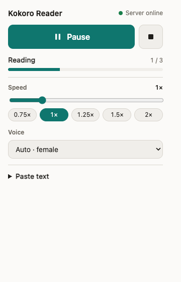
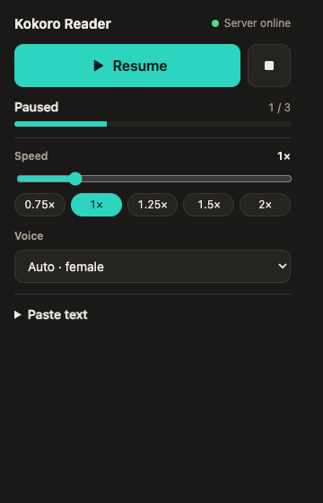

# Kokoro Reader

A Chrome extension that reads web pages and selected text aloud with
[Kokoro](https://huggingface.co/hexgrad/Kokoro-82M), a small open TTS model running on
your own machine. It sounds much more natural than the voices built into the browser,
and no text leaves your computer.

<p>
  
  
</p>

## Features

- **Fast start.** The text is split into sentences. The first audio plays in under a
  second, and the next sentences are generated while the current one plays.
- **Speed from 0.5× to 3×, changed live.** Kokoro generates the audio at up to 2×. Faster
  speeds and changes made during a reading use the audio playback rate, with pitch
  preserved, so the reading never restarts.
- **Voice choice.** *Auto · female* and *Auto · male* pick a Spanish or English voice
  from the detected language of the text. You can also pin any voice the server offers.
- **Three ways to start:** the popup, the right-click menu on a selection, or the
  keyboard shortcuts.
- **Reads the selection, or the page.** With nothing selected, it reads the page's
  `article` or `main` element, falling back to the whole body.
- **Paste text** into the popup to read anything, including text from pages extensions
  cannot access.

## Requirements

- Chrome 116 or later (or another Chromium browser).
- A Kokoro TTS server listening on `http://127.0.0.1:8880` with the API below.

### Server API

| Method | Path     | Response |
| ------ | -------- | -------- |
| `GET`  | `/voces` | `{ "voces": [{ "id": "ef_dora", "label": "Dora · Español (F)" }] }` |
| `POST` | `/leer`  | Audio (`audio/wav`) for the JSON body `{ "texto", "voz", "velocidad", "formato": "wav" }` |

`velocidad` is a number from 0.5 to 2.0. Voice ids follow Kokoro's naming: the first
letter is the language (`e` Spanish, `a` US English, `b` UK English) and the second is the
gender (`f`, `m`).

The extension sends **one synthesis request at a time**. A Kokoro server that runs
`kokoro.create` from a thread pool can fail on concurrent requests (we measured HTTP 500),
so the player queues them. Server errors 500, 502 and 503 are retried once.

## Install

1. Start the Kokoro server and check it answers:
   `curl http://127.0.0.1:8880/voces`
2. Open `chrome://extensions` and turn on **Developer mode**.
3. Click **Load unpacked** and pick this folder.
4. Pin **Kokoro Reader** to the toolbar.

If another extension already uses `Alt+R`, Chrome leaves the shortcut empty. Set it at
`chrome://extensions/shortcuts`.

## Usage

| Action | How |
| ------ | --- |
| Read the selection, or the page | Popup **Read** button, or `Alt+R` |
| Read a selection | Right-click → **Read aloud** |
| Pause / resume | Popup button, or `Alt+P` |
| Stop | Popup ■ button, `Alt+R` while reading, or right-click → **Stop reading** |
| Change speed or voice | Popup; the speed applies immediately, the voice from the next reading |

Browser pages (`chrome://`) and the Chrome Web Store cannot be read. Paste the text
instead.

## How it works

```
popup ──┐                         ┌──> offscreen document ──> Kokoro server
menu  ──┼──> background worker ───┤      (Player: queue, prefetch, <audio>)
keys  ──┘    (text extraction,    └──< state broadcasts ──> popup
              language, settings)
```

- `src/background.js`: the service worker. It extracts the text with
  `chrome.scripting`, detects the language with `chrome.i18n`, resolves the voice and
  owns the offscreen document. It watches `chrome.storage.local` and forwards speed
  changes to the player live.
- `src/offscreen/`: MV3 service workers cannot play audio, so a hidden offscreen document
  runs the `Player`.
- `src/lib/player.js`: splits the text, synthesizes chunks one at a time ahead of
  playback, plays them in order and reports `PlayerState`.
- `src/lib/contract.js`: the message types, statuses and defaults that every part shares.
- `src/popup/`: the UI. `view.js` holds its pure logic.

The offscreen document is created with the `AUDIO_PLAYBACK` and `BLOBS` reasons. With
`AUDIO_PLAYBACK` alone, Chrome closes it after 30 seconds it does not consider audible,
which cut off long readings in testing. If Chrome closes it while a reading is paused,
**Resume** recreates it and continues from the same sentence.

## Development

No dependencies and no build step: the extension loads straight from the source.

```sh
npm test   # Node's built-in test runner (Node 20+)
```

After editing, click the reload icon on the extension card in `chrome://extensions`.

## Limitations

- The voice list comes from the server. The reference server exposes 8 Spanish and
  English voices, even though the Kokoro model ships more.
- Auto voice covers Spanish and English. Other languages fall back to Spanish.
- There is no word-by-word highlighting.
